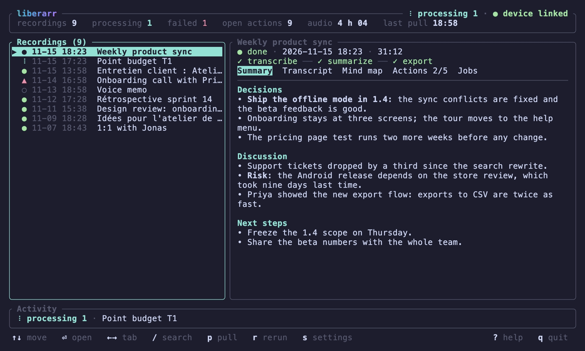
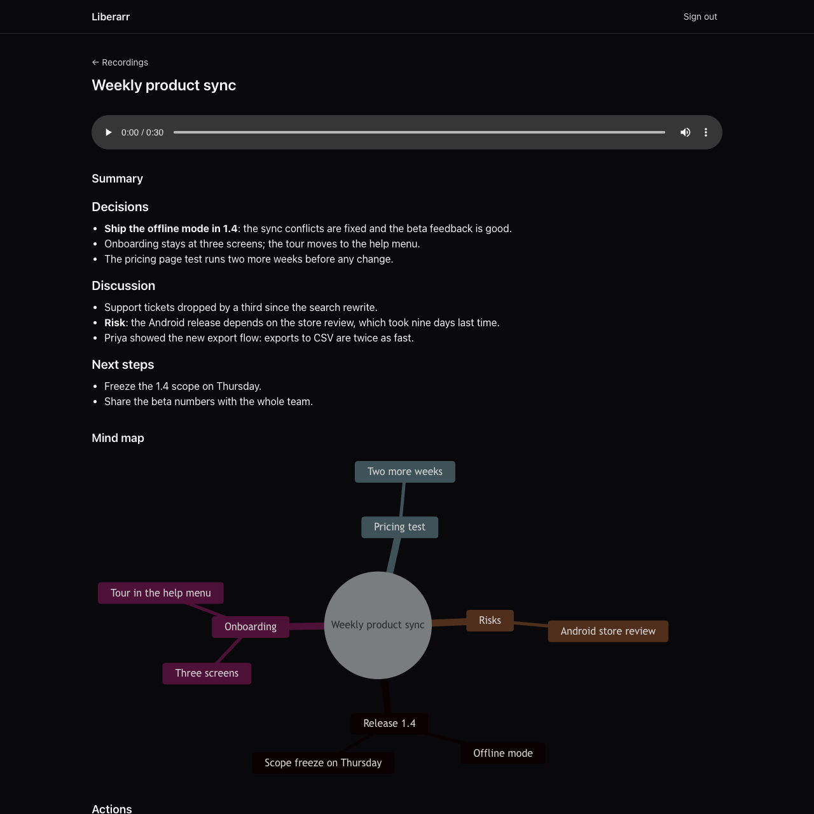

<div align="center">

<picture>
  <source media="(prefers-color-scheme: dark)" srcset="docs/assets/logo-dark.svg">
  
</picture>

**Free your Plaud recordings: transcripts, summaries and notes with the AI provider you choose.**

[](https://github.com/hocinehacherouf/liberarr/actions/workflows/rust.yml)
[](#status)
[](LICENSE)
[](https://scorecard.dev/viewer/?uri=github.com/hocinehacherouf/liberarr)

</div>

<a id="status"></a>

> [!WARNING]
> **Work in progress.** Liberarr is under active development and no release is published yet: for now, [build it from source](docs/development.md). Commands, settings and the data format can still change, and some things will break. Bug reports are welcome.

<div align="center">



<sub>The terminal app (`liberarr tui`), on fictional recordings.</sub>

</div>

Liberarr is an independent project, **not affiliated with, endorsed by or sponsored by Plaud**. "Plaud" is used only to describe the hardware it works with.

## Why Liberarr

- **Your recordings stay yours.** Audio, transcripts and summaries live in one folder on your machine. No Liberarr server, no telemetry. Only the AI providers you configure receive audio and transcripts ([privacy](docs/privacy.md)).
- **Any AI provider.** Mistral, OpenAI, Anthropic, OpenRouter, or any OpenAI-compatible endpoint such as a LiteLLM gateway. One provider for transcription, another for summaries if you like.
- **One binary.** Nothing else to install. macOS and Linux.
- **Two ways to read your results:** a full-screen terminal app and a local web UI.

## What you get

- **Device pull over Bluetooth:** `liberarr pull` copies new recordings straight off the device. Local audio files work too (`liberarr process`).
- **Transcript**, timestamped with most models, French and English mixed in the same recording.
- **Summary**, **mind map** and **action table** for each recording.
- **Obsidian export:** each recording becomes a Markdown note in the folder of your choice.
- **Terminal app** (`liberarr tui`): one dashboard with the recordings, the selected one's summary, transcript, mind map and actions to tick, the pipeline and the device pull.
- **Local web UI** (`liberarr serve`): read recordings, play the audio next to the transcript, rerun a failed step, behind a login.
- **English and French**, for the interface and for the summaries.

<div align="center">



<sub>The web UI (`liberarr serve`), on fictional recordings.</sub>

</div>

## Install

No release is published yet: for now, build from source with [docs/development.md](docs/development.md). Once a release is out, download the archive for your platform from the [releases page](https://github.com/hocinehacherouf/liberarr/releases), check it and put `liberarr` in your `PATH`: see [docs/install.md](docs/install.md). macOS (Apple silicon, Intel) and Linux (x86-64, ARM64).

## Quick start

```sh
liberarr init    # creates ~/.liberarr/.env: generated secrets, asks for your AI provider keys
liberarr link    # one-time: fetches the device keys from your Plaud account, then tests an unlock
liberarr pull    # pulls new recordings off the device, then processes them
liberarr tui     # full-screen terminal app
liberarr serve   # or the web UI on http://127.0.0.1:8484
```

`liberarr --help` and `liberarr <command> --help` describe every command and option, in English or French.

## Documentation

[docs/](docs/README.md), written for a tester starting alone:

- [Install](docs/install.md)
- [First run](docs/first-run.md): `init`, `link`, `pull`, `tui`, `serve`, `process`, `rerun`, `status`
- [Configuration](docs/configuration.md): `LIBERARR_HOME`, the `.env` file, languages
- [AI providers and costs](docs/ai-providers.md)
- [Privacy](docs/privacy.md): what leaves your machine
- [Troubleshooting](docs/troubleshooting.md)
- [FAQ](docs/faq.md), including how to keep the Plaud app alongside

## Contributing

Contributions are welcome. Start with [CONTRIBUTING.md](CONTRIBUTING.md), then build from source with [docs/development.md](docs/development.md) (web UI first, then `cargo build`). The architecture and project rules are in [AGENTS.md](AGENTS.md).

- Pick a [good first issue](https://github.com/hocinehacherouf/liberarr/issues?q=is%3Aissue+is%3Aopen+label%3A%22good+first+issue%22) or a [help wanted](https://github.com/hocinehacherouf/liberarr/issues?q=is%3Aissue+is%3Aopen+label%3A%22help+wanted%22) issue.
- Roadmap: [agent integration](https://github.com/hocinehacherouf/liberarr/issues/11), [install channels](https://github.com/hocinehacherouf/liberarr/issues/12), [speaker recognition](https://github.com/hocinehacherouf/liberarr/issues/13), [backups](https://github.com/hocinehacherouf/liberarr/issues/14).
- Found a security issue? Report it privately: see [SECURITY.md](SECURITY.md).

## License

MIT, see [LICENSE](LICENSE). Protocol credits in [NOTICE](NOTICE).
